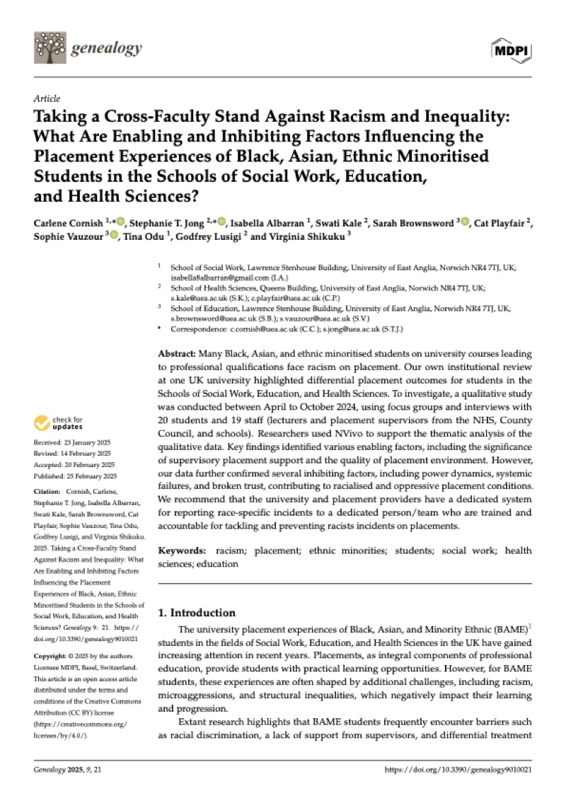
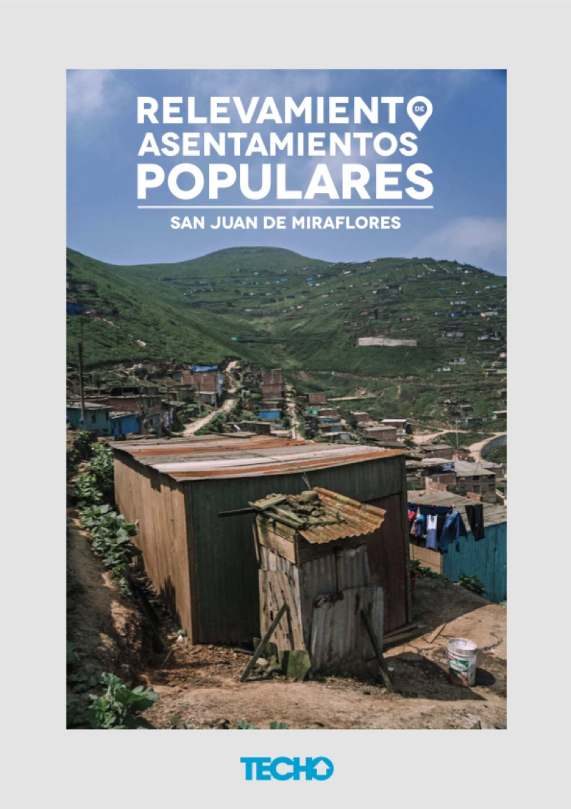

**Taking a cross-faculty stand against racism and inequality: What are enabling and inhibiting factors influencing the placement experiences of Black, Asian, ethnic minoritised students in the Schools of Social Work, Education, and Health Sciences?** *Genealogy* 9(1): 21. Universidad de East Anglia, 2025.
Investigación cualitativa con 20 entrevistas y grupos focales. [Artículo de acceso abierto](https://www.mdpi.com/2313-5778/9/1/21) · [Más sobre mi rol](/portfolio/2-uea-paper/)

---

**Informe de Relevamiento de Asentamientos Populares.** TECHO Perú, 2018.
Relevamiento de más de 130 asentamientos humanos en San Juan de Miraflores. [Informe en PDF](https://peru.techo.org/wp-content/uploads/sites/18/2021/12/InformeRelevamientoFINAL.pdf) · [Más sobre mi rol](/portfolio/3-relevamiento-techo/)
